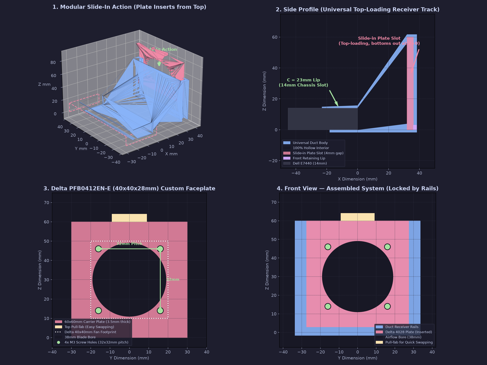
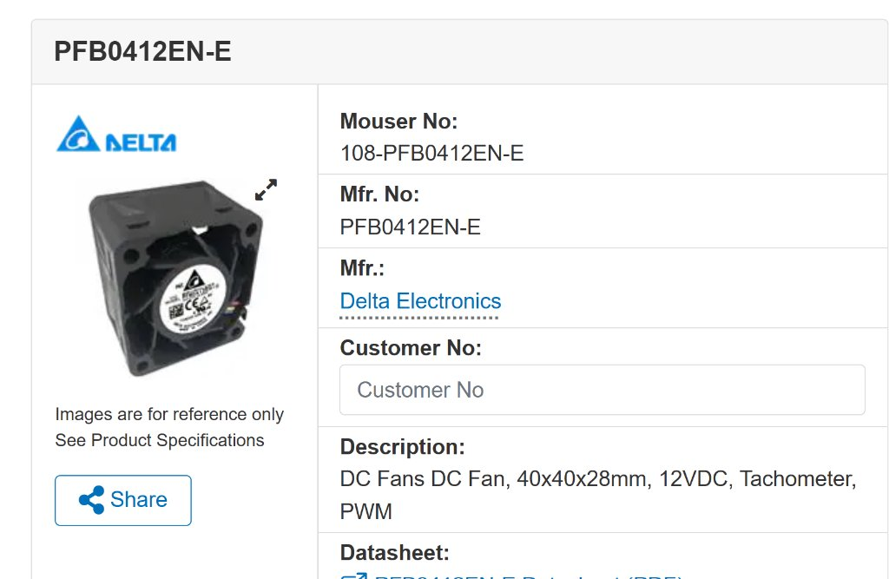

# AtiDhwani-BatDuct (अतिध्वनि) 🦇💨

**A high-pressure, modular, 3D-printable external fan duct and cooling enclosure for the Dell Latitude E7440 (and compatible laptops), featuring hot-swappable slide-in fan faceplates.**

[](https://opensource.org/licenses/MIT)
[](https://openscad.org/)
[](https://github.com/elalish/manifold)
[](#3d-printing-guidelines)

---

## 📖 Overview

When the internal CPU blower of an ultrabook like the **Dell Latitude E7440** fails, finding an exact replacement can be difficult or expensive. Traditional "cooling pads" blow air against plastic base covers with little effect on the internal dense copper radiator fins.

**AtiDhwani-BatDuct** solves this by mechanically coupling an ultra-high-pressure external fan directly to the laptop's side exhaust vent:

* **Compliant Spring-Clamp:** A tapered, flexible leaf-spring lip ($0.75\text{ mm}$ tip) slides over the laptop deck ($23.0\text{ mm}$ depth) and clamps the $14.0\text{ mm}$ chassis snugly without screws or adhesives.
* **100% Hollow Thin-Wall Duct:** Aerodynamically transitions from the $58\times 10\text{ mm}$ side vent to a universal front receiver without internal choke points or wasteful solid plastic infill.
* **Universal Slide-In Track:** Top-loading receiver slot allows **hot-swapping custom fan faceplates in 2 seconds**. Print the main laptop duct once; swap fan adapters anytime!
* **High-RPM Server Fan Support:** Includes a custom faceplate designed specifically for the **Delta Electronics PFB0412EN-E (40x40x28mm)** high-pressure server fan (or standard 60mm fans).



---

## 📐 Engineering Specifications

| Parameter | Dimension / Value | Engineering Function |
| :--- | :--- | :--- |
| **Chassis Slot Height** | **$14.0\text{ mm}$** ($+0.2\text{ mm}$ clearance) | Snug slide-in fit for Dell E7440 base at exhaust vent |
| **Deck Lip Length ($C$)** | **$23.0\text{ mm}$** ($2.3\text{ cm}$) | Matches exact deck flat before `Esc` / `Tab` keys |
| **Bottom Clamping Lip** | **$18.0\text{ mm}$** ($1.8\text{ cm}$) | Grips chassis base securely under the table line |
| **Compliant Lip Profile** | **$1.6\text{ mm} \rightarrow 0.75\text{ mm}$** taper | Thin leaf-spring tip auto-conforms to deck contours |
| **Vent Alignment** | **$58\text{ mm} \times 10\text{ mm}$** | Direct, unobstructed coupling to copper radiator |
| **Sealing Width** | **$70.0\text{ mm}$** | Extends $6\text{ mm}$ past vent edges for airtight seal |
| **Duct Funnel Length** | **$32.0\text{ mm}$** | Aerodynamic expansion; uniform $1.6\text{ mm}$ thin walls |
| **Slide-in Track Width** | **$60.8\text{ mm} \times 4.0\text{ mm}$** | Accepts standard $60\times 60\times 3.5\text{ mm}$ carrier plates |
| **Default Fan Support** | **Delta PFB0412EN-E** | 40x40x28mm (32x32mm M3 screw pitch, $\oslash 38\text{ mm}$ bore) |
| **Bonus Fan Support** | **Standard 60mm PC Fan** | 60x60x10-25mm (50x50mm M4 screw pitch, $\oslash 54\text{ mm}$ bore) |

---

## 🗂️ Repository Structure

```text
AtiDhwani-BatDuct/
├── README.md               # Main project documentation
├── LICENSE                 # MIT License
├── .gitignore              # Slicer & CAD build artifacts ignore
├── stl/                    # Ready-to-slice 3D models (Watertight Manifold)
│   ├── dell_e7440_universal_duct.stl          # Main laptop clip & receiver duct
│   ├── faceplate_delta_4028.stl               # Delta 4028 (40x40mm) slide-in plate
│   ├── faceplate_60mm_fan.stl                 # Standard 60x60mm fan slide-in plate
│   └── dell_e7440_fan_enclosure_assembled.stl # Complete reference assembly
├── cad/                    # Parametric CAD source files
│   ├── dell_e7440_fan_duct.scad               # Parametric OpenSCAD script
│   └── generate_models.py                     # Python procedural CSG generator (manifold3d)
├── docs/                   # Extended documentation
│   ├── hardware_specs.md   # Delta fan pinouts, 5V-to-12V boost wiring, PWM
│   └── print_guide.md      # Slicer settings, orientation, and infill tips
└── assets/                 # Engineering renders and diagrams
    ├── prototype_views.png
    └── delta_4028_fan.jpg
```

---

## 🖨️ 3D Printing Guidelines

* **Recommended Filament:** **PETG** or **ABS/ASA**.
  * *Note:* Laptop exhaust temperatures can reach $55^\circ\text{C}$–$70^\circ\text{C}$ under heavy load. Standard PLA softens near $55^\circ\text{C}$ and may lose its clamping tension over time. PETG offers high heat deflection ($75^\circ\text{C}$) and natural spring elasticity.
* **Orientation in Slicer:**
  * **Main Duct:** Rest the flat front receiver frame face ($67.2\times 61.6\text{ mm}$) directly on the build plate. The entire hollow cone and compliant lips print upward with **zero supports needed**.
  * **Faceplates:** Lay completely flat on the print bed.
* **Perimeters / Walls:** `4 walls` (at $0.4\text{ mm}$ line width, this makes the $1.6\text{ mm}$ shell completely solid perimeters with no sparse infill vibrations).
* **Layer Height:** `0.20 mm` (optimal for the $0.75\text{ mm}$ flexible tip).

---

## ⚡ Electrical & Fan Hookup

The featured fan is the **Delta PFB0412EN-E** ($12\text{V}$, $40\times 40\times 28\text{ mm}$, high static pressure):



### Wiring Pinout:
* **Pin 1 (Black):** Ground (`GND`)
* **Pin 2 (Red):** `+12V DC`
* **Pin 3 (Yellow):** Tachometer output (RPM sensor)
* **Pin 4 (Blue):** PWM control signal

> [!TIP]
> **Powering from USB:** You can power this fan directly from a $5\text{V}$ USB port using an inexpensive **MT3608 DC-DC Step-Up Boost Converter** tuned to $9\text{V}$–$12\text{V}$. See [`docs/hardware_specs.md`](docs/hardware_specs.md) for full schematic details.

---

## 🛠️ Parametric Customization

All CAD geometry is fully parameterized. You can adjust laptop thickness, vent dimensions, or slide-in tolerances in two ways:

1. **Using OpenSCAD:**
   Open [`cad/dell_e7440_fan_duct.scad`](cad/dell_e7440_fan_duct.scad) in [OpenSCAD](https://openscad.org/) and tweak variables at the top of the file:
   ```openscad
   render_mode    = 1;     // 1=Assembly, 2=Duct only, 3=Delta 4028 plate, 4=60mm plate
   laptop_thick   = 14.0;  // Laptop chassis thickness (mm)
   top_lip_length = 23.0;  // Deck overlap (mm)
   ```
2. **Using Python (Manifold3D):**
   Run the procedural generator script:
   ```bash
   pip install manifold3d trimesh numpy
   python cad/generate_models.py
   ```

---

## 📜 License

This project is licensed under the **MIT License** — see the [LICENSE](LICENSE) file for details.
